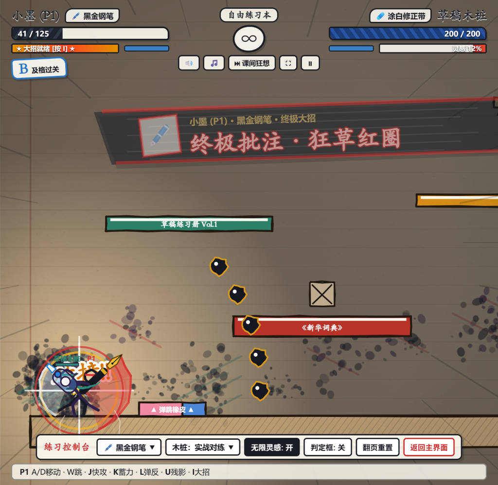
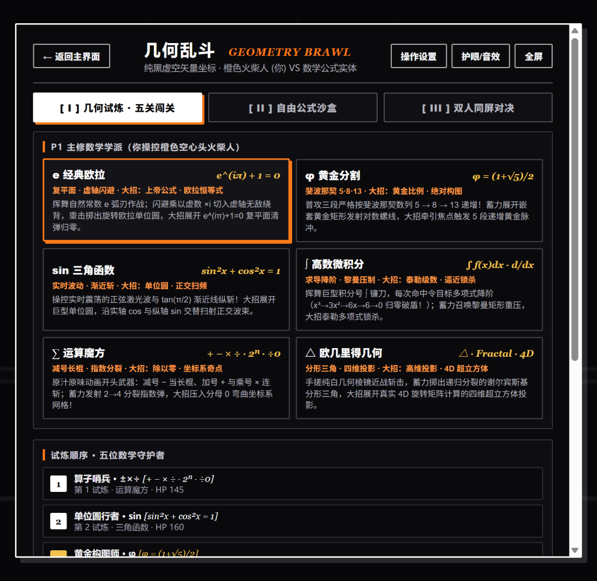
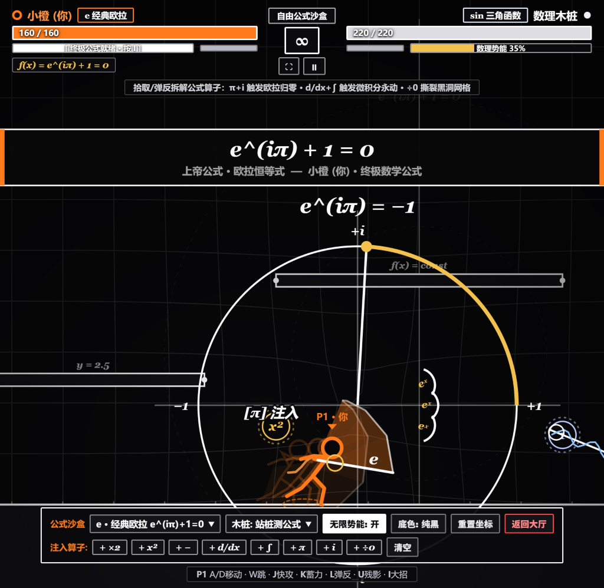
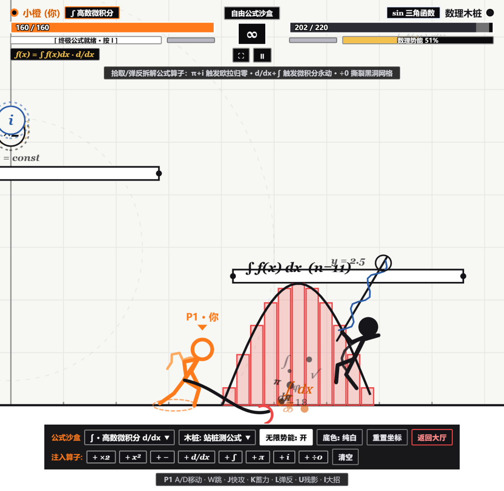

# 草稿纸大乱斗 · Scratchpad & Geometry Brawl

[](LICENSE)
[](https://github.com/keilv5c/scratchpad-brawl/releases)
[](#快速开始)

一款纯手绘矢量 / Canvas 2D + Web Audio 程序化音效打造的 Windows 火柴人格斗乱斗游戏，内置两大独立玩法模式：

1. **《草稿纸大乱斗》（Scratchpad Brawl）**：在课桌作业本与草稿纸上，用 **12 种真实校园文具武器**（黑金钢笔、尖锋圆规、美工刀×红帽图钉、涂白修正带、30cm 直尺、荧光笔等）展开横版快节奏格斗，支持闯关、肉鸽无尽、自由练习本与本地双人同屏对战。
2. **《几何乱斗》（Geometry Brawl）**：致敬经典动画 *Animation vs. Math / Geometry* 风格的纯黑虚空 / 纯白演算纸矢量格斗——操控橙色空心头火柴人，驾驭 **6 大数学学派** 与 **实时公式算子合成**，用欧拉恒等式 $e^{i\pi} + 1 = 0$、斐波那契螺旋 $\varphi$、三角波 $\sin/\cos/\tan$、黎曼积分 $\int f(x)dx$、指数分裂 $2^n$、除以零奇点 $\div 0$ 与真实 4D 超立方体投影展开数理对决。

---

## 游戏截图

| 《草稿纸大乱斗》文具终极技 | 《几何乱斗》极简黑白选人大厅 |
| :---: | :---: |
|  |  |

| 《几何乱斗》纯黑虚空 · 欧拉恒等式 $e^{i\pi}+1=0$ | 《几何乱斗》纯白演算纸 · 黎曼积分 $\int f(x)dx$ |
| :---: | :---: |
|  |  |

---

## 核心特性

### 1. 草稿纸大乱斗（Scratchpad Brawl）
- **12 种校园文具武器**：每把武器拥有独立动作模组、蓄力重击与专属终极大招。
- **4 种游玩模式**：街机闯关（含最终 Boss）、涂鸦肉鸽生存（每波词条三选一）、本地双人同屏对决、自由练习本（支持判定框开关、无限灵感、木桩行为切换）。
- **物理与手感细节**：程序化火柴人骨架 + 飘动围巾物理 + 弹跳橡皮/荧光笔增幅区/文具补给箱 + 护眼降频特效选项 + 6 首实时程序化合成 BGM。

### 2. 几何乱斗（Geometry Brawl）
- **双主题极简矢量画板**：支持 **纯黑虚空（原版动画风）** 与 **纯白演算纸（浅色矢量）** 一键切换，离屏数学符号精灵图集缓存 + 零锁帧丝滑打击节奏。
- **6 大数学学派**：
  - **$e$ 经典欧拉（$e^{i\pi}+1=0$）**：自然常数 $e$ 弧刃、虚轴 $\times i$ 相位闪避、复平面归零清弹终结技。
  - **$\varphi$ 黄金分割（$\varphi = (1+\sqrt{5})/2$）**：严格按斐波那契数列 `5 → 8 → 13` 递增的普攻三连，蓄力黄金矩形对数螺线与 5 段焦点脉冲大招。
  - **$\sin$ 三角函数（$\sin^2x+\cos^2x=1$）**：实时振荡正弦波、$\tan(\pi/2)$ 渐近线纵斩、单位圆正交波束扫频。
  - **$\int$ 高数微积分（$\int f(x)dx \cdot d/dx$）**：积分镰刀连击给目标求导降阶（$x^3 \to 3x^2 \to 6x \to 6 \to 0$ 归零破防），蓄力黎曼矩形重压与泰勒级数锁杀。
  - **$\Sigma$ 运算魔方（$+ - \times \div \cdot 2^n \cdot \div 0$）**：纯白减号 `−` 长棍连斩、$2 \to 4$ 分裂指数弹、强行压入分母 $0$ 弯曲坐标系网格奇点。
  - **$\triangle$ 欧几里得几何（$\triangle \cdot \text{Fractal} \cdot 4\text{D}$）**：递归分裂谢尔宾斯基分形三角与真实 4D 旋转矩阵超立方体（$\mathbb{R}^4 \to \mathbb{R}^2$）投影。
- **实时公式算子槽**：拾取或完美弹反拆解对手招式获得算子（$\times 2, x^2, -, d/dx, \int, \pi, i, \div 0$），组合触发 4 种恒等式连携（欧拉归零、勾股绝对归一盾、微积分永动循环、除零黑洞奇点）。
- **3 种几何玩法**：五关数学守护者试炼、自由公式沙盒（可随时切流派/注入任意算子/切黑白底色）、本地双人几何对决。

### 3. 局域网双设备直连联机（v0.4.0 新增）
- **免配置自动发现**：同一 Wi-Fi / 路由器下，房主一键建房后，客机在联机大厅通过 UDP 广播自动扫出房间一键加入，也支持手动输入 IP:端口直连（默认 TCP `27890` / UDP 发现 `27891`）。
- **低延迟零卡顿架构**：原生内置于 `.NET 8` `InkbladeDuel.exe` 中，采用 `TCP_NODELAY` 直连 + 防缓冲堆积最新帧快照通道 + 房主 60Hz 权威物理 + 客机自适应平滑插值 + 本地 60/120fps 骨架与特效解耦渲染，并实时显示 Ping 延迟。
- **双模式完整互通**：房间内可随时切换 **《草稿纸大乱斗》** 或 **《几何乱斗》**，支持 BO1 / BO3 / BO5 赛制、全地图/画板选择、双方自由镜像选武器/学派与局后秒回房间再战。

### 4. Windows 原生轻量桌面外壳
- 基于 **.NET 8 WinForms + WebView2** 封装（`desktop/`），内置虚拟本地 HTTPS 宿主与原生局域网传输引擎（`desktop/LanManager.cs`）。
- 支持 **F11 无边框全屏**、**F5 秒级热重载前端资源**、**F9 本地/远程更新包热更新**。
- 完整支持 **键鼠 360° 瞄准、纯键盘、Xbox/PS/Switch 手柄（含震动与右摇杆瞄准）及自定义改键**。

---

## 快速开始

### 方式一：直接下载 Windows 便携版（推荐）
1. 前往 [Releases](https://github.com/keilv5c/scratchpad-brawl/releases) 下载最新 `ScratchpadBrawl-v0.4.0-win-x64.zip`。
2. 解压到任意英文或中文目录，双击 **`InkbladeDuel.exe`** 即可开玩（首次开启局域网联机若弹出 Windows 防火墙提示，勾选「专用网络」允许即可）。
3. **运行环境要求**：Windows 10 / 11（64 位），需已安装 [.NET 8 Desktop Runtime (x64)](https://dotnet.microsoft.com/en-us/download/dotnet/8.0) 与系统自带的 Microsoft Edge WebView2。

### 方式二：从源码运行与编译（开发者）

**环境依赖**：
- Node.js 18+
- .NET 8 SDK（仅在需要重新编译 Windows EXE 外壳时需要）

```bash
# 1. 克隆仓库并安装前端依赖
git clone https://github.com/keilv5c/scratchpad-brawl.git
cd scratchpad-brawl
npm install

# 2. 启动浏览器本地开发模式 (默认 http://localhost:5173)
npm run dev

# 3. 编译生产版前端并一键同步/生成 Windows EXE (输出至 release/InkbladeDuel.exe)
npm run update:exe

# 4. 如需完整重编译桌面外壳 EXE
npm run build:exe
```

Windows 下也可以直接双击根目录的 **`更新游戏到EXE.bat`**（秒级热同步前端资源到 `release/app/`，打开游戏窗口按 `F5` 即刻生效）或 **`重编译桌面外壳EXE.bat`**。

---

## 默认键位一览（支持游戏内自定义改键 & 手柄）

| 操作 | 键鼠模式（默认） | 纯键盘 P1 | 纯键盘 P2（双人同屏） |
| :--- | :--- | :--- | :--- |
| 移动 | `A` / `D` | `A` / `D` | `←` / `→` |
| 跳跃 / 穿下台阶 | `Space` / 双击 `S`（或 `S+Space`） | `W` / 双击 `S`（或 `S+W`） | `↑` / 双击 `↓`（或 `↓+↑`） |
| 快攻 / 连击 | 鼠标左键 | `J` | `小键盘 1` |
| 蓄力重击 / 公式发射 | 鼠标中键（滚轮按压） | `K` | `小键盘 2` |
| 防御 / 完美弹反 | 鼠标右键 | `L` | `小键盘 3` |
| 残影冲刺 / 虚轴闪避 | `Left Shift` | `U` | `小键盘 4` |
| 终极大招 | `F` | `I` | `小键盘 5` |
| 窗口快捷键（EXE） | `F11` 全屏 · `F5` 热重载 · `F9` 检查更新 · `Esc` 暂停 | — | — |

---

## 目录结构

```text
scratchpad-brawl/
├── index.html                  # 主入口与双模式 HUD / 弹窗 DOM
├── src/
│   ├── main.ts                 # 全局 UI 控制、手柄/键鼠配置、双模式调度
│   ├── style.css               # 草稿纸手绘主题样式
│   ├── game/                   # 《草稿纸大乱斗》主循环与游戏管理
│   ├── combat/                 # 角色战斗状态机、弹道与场景互动道具
│   ├── config/                 # 12 文具武器、肉鸽词条、关卡与操作配置
│   ├── engine/                 # 输入系统（防卡键/手柄）、相机与数学工具
│   ├── physics/                # 程序化火柴人骨架、围巾物理与布娃娃
│   ├── render/                 # 手绘纸纹背景、渲染器与特效系统
│   ├── audio/                  # Web Audio 程序化打击音效与 6 首 BGM 引擎
│   ├── net/                    # 局域网联机协议、平滑插值器与双模式联机大厅控制器
│   └── geometry/               # 《几何乱斗》独立隔离模块（6 流派/合成器/矢量渲染/极简 CSS）
├── desktop/                    # Windows .NET 8 WinForms + WebView2 外壳 & 原生 LAN 引擎
├── scripts/                    # EXE 打包热更新与图标生成脚本
├── docs/screenshots/           # README 展示截图
└── LICENSE                     # MIT License
```

---

## 作者

- **可乐加冰**（[@keilv5c](https://github.com/keilv5c)）& **Gemini**

## 致谢与声明

- 《几何乱斗》模式的创意灵感致敬 Alan Becker 的经典动画系列 *Animation vs. Math* 与 *Animation vs. Geometry*。
- 本仓库所有源代码、程序化矢量图形与 Web Audio 合成音效均为原创实现，未包含任何第三方受版权保护的美术或音频素材。

## 开源协议

本项目基于 **[MIT License](LICENSE)** 开源，欢迎自由学习、修改、二次开发与分发，保留原版权声明即可。
